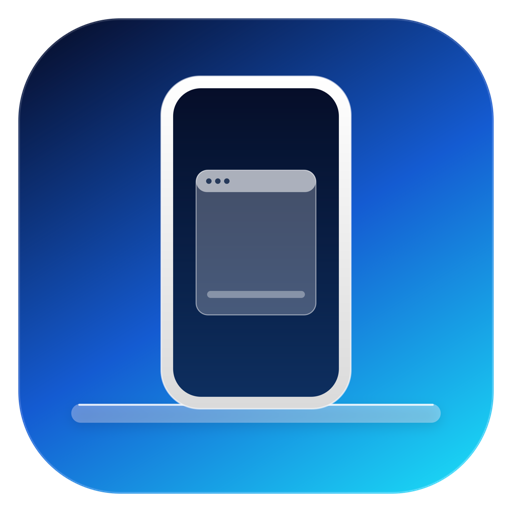

# MirrorDesk

[English](README.md) | **简体中文**

**把 Android 手机投到 Mac 上。** 一个原生 macOS 应用，通过 Wi-Fi 或 USB 投屏并控制 Android 手机，还支持在虚拟显示器上运行三星 DeX 桌面模式。不需要云账号、不需要手机端 App、不需要终端。

基于 [scrcpy](https://github.com/Genymobile/scrcpy)（Apache 2.0），已打包进应用。



## 功能

- **无线或 USB** — 通过局域网、Tailscale 或数据线使用 ADB。
- **两种模式** — 手机竖屏，或在 One UI 8+ 上用虚拟显示器运行 **DeX 桌面**（任务栏、窗口、所有应用）。
- **Mac 键盘和鼠标** — 点击即点按、滚动、拖拽；窗口标题栏内的紧凑工具条（Back / Home / Recents / All apps）跟随窗口。
- **声音** — 手机声音从 Mac 播放（Android 11+）。
- **剪贴板** — 文本双向同步；把文件/APK 拖到窗口即可推送；⌘D 从手机取回文件。
- **通知** — 连接期间，手机通知显示在 macOS 通知中心。
- **Touch ID 验证** — 投屏前用 Touch ID 或登录密码验证。
- **开箱即用** — 自带 scrcpy 和 adb；不需要 Homebrew、终端或账号。

## 要求

- Apple Silicon Mac，macOS 13 或更高。
- Android 11+ 手机，已开启 **无线调试**（开发者选项）。
- 手机和 Mac 在同一 Wi-Fi，或都在 Tailscale 上。

## 安装

1. 从 Releases 下载 `MirrorDesk-1.5.zip` 并解压。
2. 把 `MirrorDesk.app` 拖到 `/Applications`。
3. **首次打开：右键 → 打开。** 应用是 ad-hoc 签名，未公证。如果 macOS 提示「已损坏」：
   ```sh
   xattr -dr com.apple.quarantine /Applications/MirrorDesk.app
   ```
4. macOS 询问时，允许 **本地网络** 和 **通知**。

## 首次连接

1. 手机：**设置 → 开发者选项 → 无线调试 → 使用配对码配对设备**。记下 IP:端口 和 6 位配对码。
2. MirrorDesk：**Mirror → Pair phone…（⌘P）**，输入配对 IP:端口 和配对码。
3. 然后选择 **Mirror → DeX desktop（⌘2）** 或 **Phone screen（⌘1）**。

如果自动发现失败，用 **Mirror → Connect to address…（⌘L）** 输入无线调试页面上的 IP:端口。

## 工具条和快捷键

- 工具条：Back、Home、Recents、All apps（DeX）、模式切换。
- `⌘1` 手机屏 · `⌘2` DeX 桌面 · `⌘3` DeX 壁纸选择 · `⌘4` 所有应用
- `⌘P` 配对 · `⌘L` 连接地址 · `⌘D` 取文件 · `⌘.` 停止
- 投屏窗口内：`⌥H` 主屏 · `⌥B` 返回 · `⌥S` 最近任务 · `⌥F` 全屏 · `⌥O` 关闭手机屏幕
- 右键 = 返回，中键 = 主屏。

## 鼠标、滚动和工具条

- **滚动太快？** 由三星的滚轮速度设置决定。用 **Mirror → Input → Scroll speed**（Slowest 0 … Fastest 10），它会写入手机的 `mouse_scrolling_speed`。手机端同一滑块在 **设置 → 常规管理 → 鼠标和触控板 → 滚轮滚动速度**，拉到最左最慢。
- **快速滑动时指针乱跳？** Android 会对注入的（UHID）鼠标事件做指针加速，快速滑动会过冲。关闭 **Mirror → Input → Disable pointer acceleration**（写入 `mouse_pointer_acceleration=1`，三星上 1 = 关闭）。手机端：**设置 → Samsung DeX → 鼠标和触控板 → 更多设置 → 增强指针精度 关闭**。用 **Mirror → Input → Pointer speed** 调光标速度（Slow 0 … Fastest 7）。
- **DeX 里鼠标被捕获？** 默认 UHID 鼠标会被捕获：按一下 **⌥（Option）** 把光标放回 Mac，再按一下 ⌥ 重新捕获。如果不想被捕获，打开 **Mirror → Input → Absolute mouse (no capture)**（会重启投屏）。
- **工具条**：固定在窗口标题栏右上角（原生红黄绿按钮旁边），只在投屏窗口位于当前 Space 且在前台时显示。想隐藏：**Mirror → Show title-bar toolbar** 取消勾选。

## 为什么感觉像隔了一层虚拟机（延迟）

指针是在 DeX 里渲染的，再通过视频传回 Mac，所以你看到的是「延迟版」的光标；UHID 模式下 Mac 光标会被捕获并隐藏。默认 `--video-buffer=100` 是用约 100ms 延迟换更少的丢帧。DeX 虚拟屏是 60Hz，Mac 屏是 120Hz。

想更接近原生：

- **Absolute mouse (no capture)** — Mac 光标留在本地，按 Mac 刷新率移动；点击/滚动按绝对位置注入。DeX 可能不画自己的光标。
- **Low latency mode** — `--video-buffer=0`、16M 码率：更跟手，但可能丢更多帧。
- **LAN 或 USB** — 这里 LAN/Tailscale 约 6-13ms；USB 没有网络跳数。
- scrcpy 的 40ms 输入重采样补丁（issue #4697）可以消除加速度抖动，但上游还没实现。

## 限制

- 虚拟显示器上的 DeX **没有壁纸** — Android 只把壁纸绑定到主显示器。
- DRM / `FLAG_SECURE` 应用（Netflix、密码管理器、Secure Folder）投屏为黑屏。
- 连接期间通知每 3 秒轮询一次（不是推送）；没有 Live Activities、Spotlight 集成或小组件。
- 虚拟显示器上的 DeX 是三星未公开的行为，One UI 更新可能导致失效。
- 仅支持 Apple Silicon（自带 scrcpy 是 arm64）。
- 需要开启开发者选项 / 无线调试，这会授予 ADB 对手机的完全控制权 — 只配对信任的 Mac。

## 从源码构建

```sh
./build.sh
```

需要 Xcode 命令行工具。脚本会下载官方 scrcpy macOS arm64 版本、校验其 SHA-256、编译 Swift 应用、生成图标并 ad-hoc 签名。

## 许可证

Apache License 2.0。见 `LICENSE` 和 `NOTICE`。scrcpy 和 adb 也是 Apache 2.0 — 见 `THIRD_PARTY_NOTICES.md`。

## 免责声明

MirrorDesk 是独立项目，与三星、Google、Apple、Genymobile 或 scrcpy 维护者没有关联、背书或赞助关系。Android 是 Google LLC 的商标，macOS 是 Apple Inc. 的商标，Samsung 和 DeX 是 Samsung Electronics 的商标。
